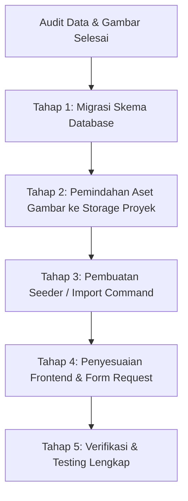

# Implementation Plan: Integrasi Master Data Fasilitas & Aset Gambar UNDIP

Dokumen ini merinci rencana teknis integrasi data fasilitas (103 fasilitas hasil scraping/kurasi) ke dalam basis data dan aplikasi **Reservation & Reporting System (CAVA / UNDIP)**.

---

## 1. Ringkasan Eksekutif & Hasil Analisis

### 1.1 Status Kesesuaian Database & Website
Berdasarkan audit komparasi antara data CSV (`facilities_undip_lengkap.csv`) dengan struktur skema database (`facilities` table) dan tampilan Blade frontend:

| Kolom CSV | Skema Saat Ini | Status Kompatibilitas | Temuan & Solusi |
| :--- | :--- | :--- | :--- |
| `code` | `VARCHAR(30) UNIQUE` | **Valid** | Semua 103 kode unik, panjang < 15 karakter. |
| `name` | `VARCHAR(150)` | **Konflik Panjang Data (Fatal)** | 5 fasilitas memiliki nama > 150 karakter (hingga 198 karakter). **Solusi:** Naikkan ke `VARCHAR(255)`. |
| `category` | `ENUM('auditorium','lab','kelas','olahraga','rapat')` | **Konflik Nilai ENUM (Fatal)** | Terdapat 6 fasilitas dengan kategori `ruang_kerja`. **Solusi:** Tambahkan `ruang_kerja` ke enum database & form validasi. |
| `floor_location` | `VARCHAR(50) NULL` | **Konflik Panjang Data (Fatal)** | 35 fasilitas memiliki panjang lokasi lantai > 50 karakter (hingga 60 karakter). **Solusi:** Naikkan ke `VARCHAR(100)`. |
| `building` | `VARCHAR(100)` | **Valid** | Panjang maksimal 51 karakter. |
| `capacity` | `UNSIGNED INT` | **Valid** | Semua data integer valid (rentang 20 - 4.500 kursi). |
| `equipment` | `JSON NULL` | **Valid** | Semua data berformat JSON string array yang valid. |
| `description` | `TEXT NULL` | **Valid** | Deskripsi naratif lengkap dan muat dalam batas `TEXT`. |
| `status` | `ENUM('aktif',...)` | **Valid** | Semua status bernilai `'aktif'`. |
| `source_origin` | *Belum ada* | **Metadata Tambahan** | Menampung asal unit/fakultas (FT, FSM, UPT Lab Terpadu, Sarpras). **Solusi:** Buat kolom `VARCHAR(100) NULL`. |
| `image_path` | `VARCHAR(255)` | **Format Prefix Perlu Normalisasi** | Nilai di CSV: `/storage/facilities_clean/...`. Helper Blade memanggil `asset('storage/' . $facility->image_path)`. Jika tidak di-strip, URL menjadi `/storage//storage/...`. **Solusi:** Simpan format relatif `facilities_clean/...`. |

---

### 1.2 Status Keterhubungan `image_path` dengan Komputer Lokal
- **File Fisik Ditemukan**: Folder sumber berada di komputer lokal Anda:  
  `C:\Users\VICTUS\OneDrive\ドキュメント\Scrapping\public\storage\facilities_clean\`
- **Integritas Aset**: **103 dari 103 file `.webp` (100%)** yang dicantumkan dalam CSV tersedia secara fisik di folder scraping tersebut.
- **Kondisi Proyek Saat Ini**: Folder `storage/app/public/facilities_clean` di dalam direktori repositori **belum dibuat** dan file belum disalin.
- **Kesimpulan**: Gambar **belum terhubung langsung ke proyek**, namun aset lokal lengkap dan siap disalin ke direktori publik Laravel.

---

## 2. Rencana Implementasi Bertahap

---

### Tahap 1: Migrasi Skema Database (`facilities` table)
Membuat file migrasi baru (non-destructive) untuk menyesuaikan kapasitas kolom dan menambah enum:
- File migrasi: `database/migrations/2026_10_11_000001_update_facilities_table_schema_and_categories.php`
- Perubahan yang diterapkan:
  1. `name`: Mengubah tipe kolom menjadi `VARCHAR(255)`.
  2. `floor_location`: Mengubah tipe kolom menjadi `VARCHAR(100)`.
  3. `category`: Mengubah enum menjadi `['auditorium', 'lab', 'kelas', 'olahraga', 'rapat', 'ruang_kerja']`.
  4. `source_origin`: Menambahkan kolom `VARCHAR(100) NULL` setelah `name`.

---

### Tahap 2: Pemindahan dan Penghubungan Aset Gambar Lokal
1. Membuat direktori tujuan:
   `c:\Users\VICTUS\OneDrive\ドキュメント\reservation-reporting-system\storage\app\public\facilities_clean`
2. Menyalin seluruh 103 file `.webp` dari:
   `c:\Users\VICTUS\OneDrive\ドキュメント\Scrapping\public\storage\facilities_clean\`  
   ke:  
   `storage/app/public/facilities_clean/`
3. Memastikan symlink `public/storage` (Junction ke `storage/app/public`) mengenali folder `facilities_clean`.

---

### Tahap 3: Pembuatan Seeder / Script Import CSV
1. Membuat seeder baru: `database/seeders/ImportFacilitiesFromCsvSeeder.php`
2. Logika impor:
   - Membaca file CSV dari `database/data/facilities_undip_lengkap.csv` (atau path scraping).
   - Memangkas prefix `/storage/` pada `image_path` menjadi `facilities_clean/{nama_file}.webp`.
   - Melakukan decode/formatting atribut JSON `equipment`.
   - Menggunakan `Facility::updateOrCreate(['code' => $row['code']], [...])` agar idempotent (dapat dijalankan berulang tanpa menduplikasi data).
3. Mendaftarkan seeder ke dalam `database/seeders/DatabaseSeeder.php`.

---

### Tahap 4: Penyesuaian Model, Form Request & Tampilan Frontend
1. **Model `Facility.php`**:
   - Menambahkan `'source_origin'` ke `$fillable`.
2. **Form Request**:
   - Update `app/Http/Requests/Admin/StoreFacilityRequest.php`: tambahkan `'ruang_kerja'` ke validasi `in:...`.
   - Update `app/Http/Requests/Admin/UpdateFacilityRequest.php`: tambahkan `'ruang_kerja'` ke validasi `in:...`.
3. **Blade Frontend & Filter**:
   - Update `resources/views/admin/facility-master.blade.php`: tambahkan filter dan label badge untuk kategori `ruang_kerja` (`Ruang Kerja / Co-Working`).
   - Verifikasi `resources/views/public/catalog.blade.php`: memastikan pill filter kategori mencakup `ruang_kerja` dan gambar fasilitas termuat dengan tajam tanpa broken image.

---

### Tahap 5: Verifikasi & Uji Coba (Testing)
1. Menjalankan `php artisan migrate`.
2. Menjalankan `php artisan db:seed --class=ImportFacilitiesFromCsvSeeder`.
3. Menjalankan `php artisan test` untuk memastikan semua pengujian backend tetap hijau (PASS).
4. Verifikasi visual:
   - Halaman Publik Katalog: [http://localhost:8000/public/catalog](http://localhost:8000/public/catalog)
   - Halaman Kalender Ketersediaan: [http://localhost:8000/public/availability](http://localhost:8000/public/availability)
   - Halaman Master Fasilitas Admin: [http://localhost:8000/admin/facility-master](http://localhost:8000/admin/facility-master)

---

## 3. Matriks Risiko & Mitigasi

| Risiko | Dampak | Mitigasi |
| :--- | :--- | :--- |
| Error panjang nama fasilitas | Impor terhenti (SQL Error 1406) | Jalankan migrasi `VARCHAR(255)` sebelum melakukan impor data. |
| Error enum `ruang_kerja` | Impor terhenti (Data truncated) | Daftarkan `ruang_kerja` pada enum tabel MySQL terlebih dahulu. |
| Broken image di website | Gambar tidak muncul (404) | Pastikan file disalin ke `storage/app/public/facilities_clean` dan format path di database tidak memiliki awalan ganda `/storage/`. |
| Duplikasi data saat re-seeding | Data ganda di katalog | Menggunakan metode `updateOrCreate` berbasis kolom unik `code`. |
